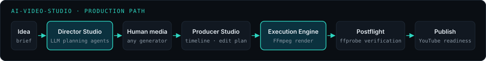
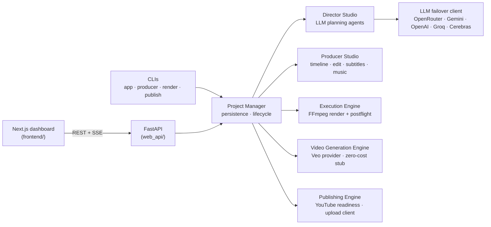
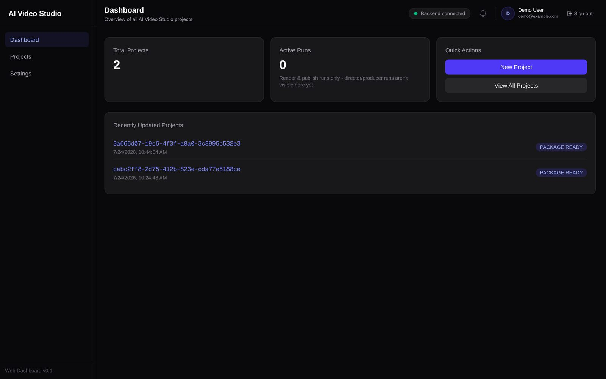
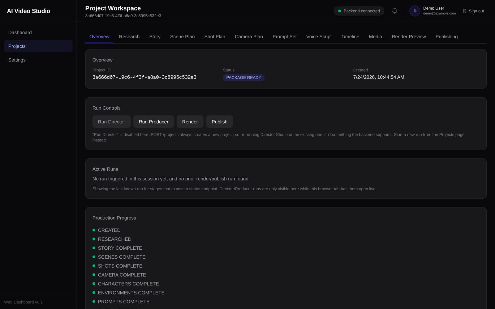
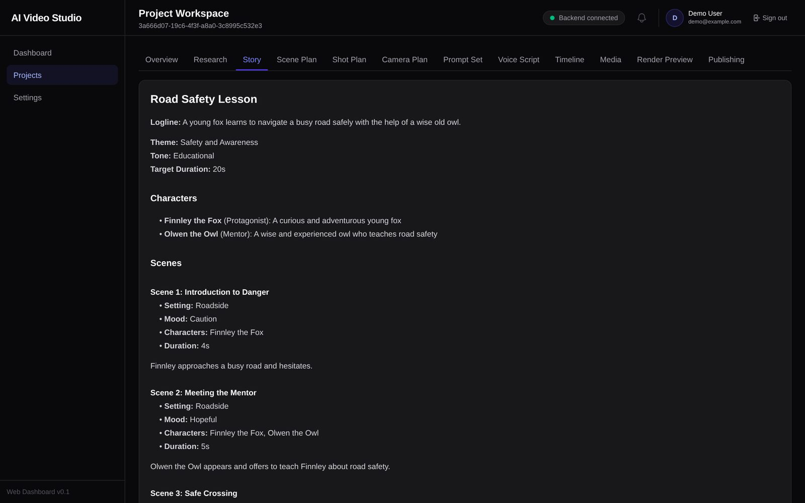
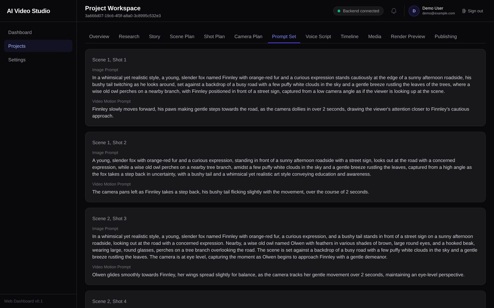

# AI Video Studio

**A multi-agent platform that turns an idea into a planned, rendered and verified video.** LLM planning agents write the production plan, a human supplies the media with whatever tools they prefer, a deterministic producer builds the edit, FFmpeg renders it, and ffprobe postflight checks decide whether the result actually counts as done.

[](https://github.com/tawsif-raza/ai-video-studio/actions/workflows/ci.yml)



## Why it's built this way

Generating media is the easy, swappable part; the hard part is **planning and assembly**: story structure, shot coverage, keeping characters and environments consistent across prompts, and producing a render you can trust. The platform is designed around that:

- **Contracts over conversation.** Agents never pass ad hoc dicts. Every hand-off is a typed Pydantic contract (`shared_core/contracts/`), validated at the boundary.
- **Two-layer validation for LLM output.** Shape (does the JSON match the schema?), then business rules (is the content actually right?).
- **Verify outputs, not processes.** A render reaches `VIDEO_RENDERED` only when ffmpeg succeeded *and* an independent ffprobe check of the file confirms its streams, resolution, fps and duration.
- **The human checkpoint is a feature.** Between planning and production the human generates images, video and voice with any tool (Gemini, Veo, Flux, Midjourney, ElevenLabs...) and picks the best takes.
- **One owner of state.** `project_manager/` is the only component that touches storage; the studios and engines take typed inputs and return typed results.

The full design (25 sections, kept in sync with the code) is in [`ARCHITECTURE.md`](ARCHITECTURE.md).

## Components



| Component | Path | What it does |
|---|---|---|
| Director Studio | `director_studio/`, `agents/` | Research, story, scenes, shots, characters, environments, camera, voice script and prompt agents produce a **Production Package** |
| Producer Studio | `producer_studio/` | Validates imported media, then deterministically plans timeline, subtitles, music, editing, thumbnail and publishing metadata into a **Producer Package** |
| Execution Engine | `execution_engine/` | Preflight, FFmpeg command and filter-graph building, segmented rendering, ffprobe postflight verification |
| Video Generation Engine | `video_generation_engine/` | Provider registry with a Google Veo provider and a local stub that makes no network calls |
| Publishing Engine | `publishing_engine/` | OAuth credential handling and publish-readiness checks. A resumable YouTube upload client with persisted sessions exists at the platform layer but isn't wired to the CLI or dashboard yet |
| LLM layer | `llm/` | Per-provider clients plus a failover client that rotates keys and providers on quota, rate-limit, auth or transient errors |
| Web API | `web_api/` | Projects, media upload, run dispatch with a concurrency cap and timeouts, run registry (in-memory or Postgres), SSE run events, cookie/JWT auth with per-project authorization. See [`docs/API.md`](docs/API.md) |
| Dashboard | `frontend/` | Next.js + TypeScript UI for creating projects, uploading media, and watching runs live |

## Quick start

Requirements: Python 3.12, ffmpeg on `PATH`, and at least one LLM API key for the Director Studio.

```bash
git clone https://github.com/tawsif-raza/ai-video-studio.git
cd ai-video-studio/ai_video_studio
python -m venv .venv && source .venv/bin/activate
pip install -r requirements.txt

cp .env.example .env   # then fill in at least one LLM key
```

Key settings (read in `config.py`; any one LLM key is enough):

| Variable | Purpose |
|---|---|
| `OPENROUTER_API_KEY`, `GEMINI_API_KEY`, `OPENAI_API_KEY`, `GROQ_API_KEY`, `CEREBRAS_API_KEY` | LLM providers for the failover client. The `*_API_KEYS` variants accept several keys for rotation |
| `OUTPUT_DIR` | Where projects are stored (default `outputs/`) |
| `DB_HOST`, `DB_PORT`, `DB_NAME`, `DB_USER`, `DB_PASSWORD` | Optional Postgres run registry. Blank means in-memory |
| `PIPELINE_MAX_CONCURRENCY`, `PIPELINE_TIMEOUT_SECONDS` | Background run limits for the API |
| `GOOGLE_VEO_API_KEY` | Only for the opt-in Veo provider |

### Run from the command line

```bash
python app.py --idea "A lighthouse keeper befriends a storm" --duration 60   # Director Studio -> Production Package
# ...generate media with your own tools and drop it into the project's media folders...
python producer_app.py --project-id <id>                                       # Producer Studio -> Producer Package
python render_app.py   --project-id <id> --resolution 1920x1080 --fps 30       # FFmpeg render + postflight
python publish_app.py  --project-id <id> --platform youtube                    # publish-readiness report (exit 1 = not ready)
```

### Run the API and dashboard

```bash
uvicorn api_app:app --reload                         # http://127.0.0.1:8000  (GET /health, /health/ready)
cd ../frontend && npm ci && npm run dev               # http://localhost:3000  (NEXT_PUBLIC_API_BASE_URL defaults to :8000)
```

Endpoints, the run lifecycle, SSE event names and error codes are documented in [`docs/API.md`](docs/API.md); the live schema is at `/docs` once the API is running.

## Dashboard

Captured from a local production build against the local API, showing two projects produced by real Director Studio runs.

<table>
  <tr>
    <td width="50%"></td>
    <td width="50%"></td>
  </tr>
  <tr>
    <td><b>Dashboard</b>: projects and active render/publish runs</td>
    <td><b>Project workspace</b>: run controls and lifecycle state</td>
  </tr>
  <tr>
    <td width="50%"></td>
    <td width="50%"></td>
  </tr>
  <tr>
    <td><b>Story</b>: Director Studio's story plan</td>
    <td><b>Prompt set</b>: per-shot image and motion prompts for any generator</td>
  </tr>
</table>

## Testing

```bash
cd ai_video_studio && python -m pytest -q        # ~940 tests; LLM, YouTube and Veo calls are faked
cd frontend && npm test && npm run lint           # Vitest + ESLint
```

- Tests under `tests/db/` exercise the Postgres run registry against a real database and skip when none is reachable. To run them locally: `docker run -d -e POSTGRES_PASSWORD=testpass -e POSTGRES_DB=ai_video_studio_test -p 15432:5432 postgres:16-alpine`.
- FFmpeg-dependent tests skip if `ffmpeg` isn't installed.
- [CI](.github/workflows/ci.yml) runs both suites on every push and PR, with a Postgres 16 service container so the DB tests run too. No secrets required.

## Deployment

| Target | Files | Notes |
|---|---|---|
| Railway (API) | `ai_video_studio/railway.json`, `nixpacks.toml` | `uvicorn api_app:app`, health check on `/health` |
| Vercel (dashboard) | `frontend/vercel.json` | Set `NEXT_PUBLIC_API_BASE_URL` to the API URL |
| Docker | `Dockerfile`, `ai_video_studio/Dockerfile` | Container image for the API |
| AWS (planned) | `infra/`, `docs/aws-production-architecture.md` | Terraform for ECS Fargate + SQS worker + RDS + S3. Validated, **not applied**; see `infra/README.md` |

## Known limitations

- The render stage reports coarse progress (queued → rendering → done); the FFmpeg engine doesn't emit intermediate progress yet.
- Open follow-ups are tracked in [issues](https://github.com/tawsif-raza/ai-video-studio/issues): peak ffmpeg memory on long 1080p multi-scene renders, media-count refresh delay after upload, and no API to delete previously uploaded media.
- Publishing targets YouTube only, and actually triggering an upload from the CLI or dashboard is not wired up yet. Today `publish_app.py` and the API report readiness.

## License

© 2026 Tawsif Khan. All rights reserved. The source is public for review; no license to reuse it is granted.
