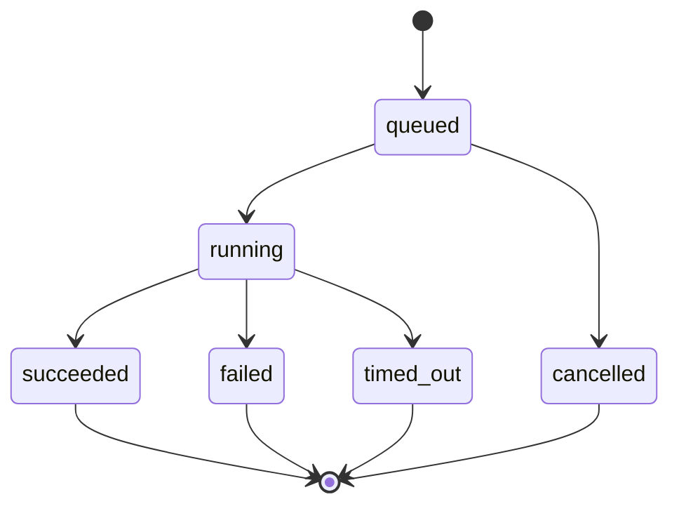

# Web API reference

The FastAPI app in `ai_video_studio/web_api/` (started with `uvicorn api_app:app`). This page was written from the app's generated OpenAPI schema plus the router source. For the live, always-current schema, run the API and open **`/docs`** (Swagger UI) or **`/openapi.json`**.

- [Authentication](#authentication)
- [Run lifecycle](#run-lifecycle)
- [Endpoints](#endpoints)
- [Server-Sent Events](#server-sent-events)
- [Errors](#errors)
- [Security notes](#security-notes)

## Authentication

The `/auth/*` routes are also mounted under `/api/auth/*` with identical behavior.

| Method | Path | Body | Notes |
|---|---|---|---|
| POST | `/auth/register` | `{email, password, full_name}` | 201; sets the session cookie and also returns `access_token` |
| POST | `/auth/login` | `{email, password}` | Sets the session cookie |
| GET / PATCH | `/auth/me` | `UserUpdate` for PATCH | Current user |
| PATCH | `/auth/me/password` | `UserPasswordUpdate` | |
| POST | `/auth/logout` | | Clears the cookies |
| POST | `/auth/forgot-password`, `/auth/reset-password` | | Reset email via SES when configured |

A request is authenticated by **either** an `Authorization: Bearer <jwt>` header **or** the HTTP-only `access_token` / `session_token` cookie. Cookie `Secure` and `SameSite` are derived from `ENVIRONMENT`, and the app refuses to start with insecure cookie settings outside development (`config.py`).

**Project access:** a project created by an authenticated user is owned by them. Any other caller, authenticated or not, gets **404** (not 403), so project ids can't be probed. Projects with no owner (created anonymously, or by the CLI) are accessible to anyone.

## Run lifecycle

Long-running work (Director, Producer, Render, Publish) is started with a `POST` that returns **202** immediately:

```json
{ "project_id": "…", "run_id": "…", "status": "queued" }
```

The work then runs on a bounded thread pool (`PIPELINE_MAX_CONCURRENCY`, default 4), with a per-run timeout (`PIPELINE_TIMEOUT_SECONDS`).



- Each project can have **one active run at a time**; a second `POST …/run` gets **409**.
- `succeeded` means the *request* completed. For render runs, check `output_ok` on `GET …/render/status` (or `result.render.success` / `result.validation.is_valid`): an ffmpeg failure or a failed postflight check is reported there, not as a `failed` run.
- A timed-out run releases its concurrency slot immediately; if its thread finishes later, the late result is discarded.

## Endpoints

### Projects and media

| Method | Path | Body | Success |
|---|---|---|---|
| POST | `/projects` | `CreateProjectRequest` | 202 `RunAccepted`. Creates the project **and** starts a Director Studio run |
| GET | `/projects` | | 200, the caller's projects, newest first |
| GET | `/projects/{project_id}` | | 200 `Project` |
| DELETE | `/projects/{project_id}` | | 204 |
| POST | `/projects/{project_id}/media` | multipart `file` | 201. Images `png/jpg/jpeg`, video `mp4/mov`, audio `wav/mp3/m4a` |
| GET | `/projects/{project_id}/media` | | 200, what's imported, by category |
| DELETE | `/projects/{project_id}/media/{category}/{filename}` | | 204. `category` is `images`, `video` or `audio` |
| POST | `/projects/{project_id}/media/bulk-delete` | `{items: [...]}` | 200 |
| GET | `/projects/{project_id}/production-package` | | 200. Director Studio output; 404 until generated |
| GET | `/projects/{project_id}/producer-package` | | 200. Producer Studio output; 404 until generated |

`CreateProjectRequest`:

| Field | Default | |
|---|---|---|
| `idea` | required | The story idea |
| `duration_seconds` | `150` | Target length |
| `tone`, `audience`, `art_style` | – | Optional creative direction |
| `skip_research` | `false` | Skip the research agent |
| `scene_count_mode`, `scene_count` | `"default"`, – | Override how many scenes are planned |

### Pipeline stages

| Method | Path | Body | Success |
|---|---|---|---|
| POST | `/projects/{project_id}/producer/run` | | 202. Validates imported media during the run; missing shots are reported in `result.asset_validation.missing_shot_count` (rendered as black frames), not rejected up front |
| POST | `/projects/{project_id}/render/run` | `RenderRunRequest` | 202. Project must be `EDIT_PLAN_READY` (else 400) |
| GET | `/projects/{project_id}/render/status` | | 200 with `status`, `current_stage`, `progress`, `error`, `output_ok`, `output_error` |
| GET | `/projects/{project_id}/render/video` | | 200 `video/mp4`, supports HTTP range requests |
| POST | `/projects/{project_id}/publish/run` | `{platform: "youtube", dry_run: false}` | 202. Produces a publish-readiness report; it does not upload |
| GET | `/projects/{project_id}/publish/status` | | 200, plus the project's current state |
| GET | `/runs/{run_id}` | | 200 `Run`, including the stage `result` once terminal |

`RenderRunRequest` defaults: `resolution "1920x1080"`, `fps 30`, `video_codec "libx264"`, `audio_codec "aac"`, `crf 20`, `preset "ultrafast"`, `threads 1`, `pix_fmt "yuv420p"`, `subtitle_mode "soft"`, `dry_run false`, `timeout_seconds 120`.

### Health and metadata

| Path | Meaning |
|---|---|
| `GET /health` | Process is up (Railway health check) |
| `GET /health/live` | Liveness |
| `GET /health/ready` | Readiness: `OUTPUT_DIR` is writable, else **503** |
| `GET /version` | `{"api_version": "0.1.0", "service": "ai-video-studio-api"}` |

## Server-Sent Events

| Path | Streams |
|---|---|
| `GET /runs/{run_id}/events` | One run |
| `GET /projects/{project_id}/events` | The project's most recently started run, whatever its stage |

Wire format: `text/event-stream`, one message per event (`event: <name>\ndata: <json>\n\n`), with `Cache-Control: no-cache` and `X-Accel-Buffering: no` so proxies don't buffer. The server polls the run registry and emits events **only on status transitions**, and closes the stream when the run reaches a terminal state. A client that connects after the run has finished receives the final outcome immediately.

| Event | Payload | When |
|---|---|---|
| `run_started` | `{run_id, project_id, type, status}` | Run enters `running` |
| `stage_changed` | `{current_stage}` | Run enters `running` |
| `progress` | `{progress}` | `50` when running, `100` at the end. The engines don't report finer progress yet |
| `completed` | `{status}` | `succeeded` |
| `failed` | `{status, error}` | `failed` |
| `timed_out` | `{status, error}` | `timed_out` |
| `cancelled` | `{status, error}` | `cancelled` |

Browser example:

```js
const es = new EventSource(`${API}/runs/${runId}/events`, { withCredentials: true });
es.addEventListener("completed", () => es.close());
es.addEventListener("failed", (e) => console.error(JSON.parse(e.data).error));
```

## Errors

| Code | Meaning |
|---|---|
| 400 | Request is valid JSON but not allowed in the project's current state (e.g. render before `EDIT_PLAN_READY`), or an unsupported upload extension |
| 401 | Missing, invalid or expired token on an endpoint that requires a user |
| 404 | Unknown project, or a project the caller doesn't own. Also a package or run that doesn't exist yet |
| 409 | A run is already active for this project |
| 422 | Body or path failed validation (FastAPI's standard error shape) |
| 503 | `/health/ready` could not write to `OUTPUT_DIR` |

Errors use FastAPI's `{"detail": ...}` body.

## Security notes

Observations from reading the code; recommendations are not yet implemented.

- **Uploads:** the filename is reduced to its basename before use (blocks path traversal) and checked against an extension allowlist. There is **no application-level size limit**, so set one at the reverse proxy. The upload response includes the server-side `path`.
- **Anonymous use:** `POST /projects` accepts unauthenticated requests and starts an LLM-backed Director run. On a public deployment, consider requiring authentication there so provider credits can't be spent by anyone.
- **Listing:** an unauthenticated `GET /projects` returned owned projects in earlier versions; see [#7](https://github.com/tawsif-raza/ai-video-studio/pull/7).
